<p align="center">
  
  
  
  
  
  
  
</p>

<h1 align="center">启凌智搭 · 管理后台前端（ainb-ui-admin-vue3）</h1>

<p align="center">
  <b>AI 原生低代码平台</b><br>
  以 AI 为引擎，重新定义企业数字化；让最懂业务的人，自己把应用建出来。
</p>

<p align="center">
  <a href="https://demo.enlev.cn"><b>🔥 在线演示</b></a> &nbsp;|&nbsp;
  <a href="https://doc.enlev.cn"><b>📚 官方文档</b></a> &nbsp;|&nbsp;
  <a href="https://doc.enlev.cn/guide/"><b>使用手册</b></a> &nbsp;|&nbsp;
  <a href="https://doc.enlev.cn/develop/"><b>开发手册</b></a> &nbsp;|&nbsp;
  <a href="https://gitee.com/enlev/ainb"><b>后端仓库</b></a> &nbsp;|&nbsp;
  <a href="https://gitee.com/enlev/ainb-ui-admin-uniapp"><b>移动端仓库</b></a>
</p>


**启凌智搭**的前端不是一个「后台模板」，而是低代码平台的**运行时宿主**：表单设计器、门户设计器、流程编排画布、资源授权树、AI 助手对话流 —— 这些界面本身就是产品能力，业务应用在浏览器里被拖出来、发布、然后立刻能用。

---

## 🐶 新手必读

- **Node ≥ 20.19.0 && pnpm ≥ 8.6.0**（🔴 **强制使用 pnpm**，`package.json` 的 `engines` 已钉住）
- **在线演示**：<https://demo.enlev.cn>
- **官方文档**：<https://doc.enlev.cn>
- **后端仓库**：[ainb](https://gitee.com/enlev/ainb)
- **移动端仓库**：[ainb-ui-admin-uniapp](https://gitee.com/enlev/ainb-ui-admin-uniapp)（同一套后端与权限体系，H5 / 微信小程序 / App）
- **五分钟跑起来**：见下文 [🚀 快速开始](#-快速开始)

### 演示账号

平台是 SaaS 多租户 + 资源授权模型，**同一个页面在不同身份下长得不一样**。五个账号密码均为 `admin123`：

| 视角 | 账号 | 租户名称 | 角色 | 用来演示 |
| --- | --- | --- | --- | --- |
| 超管 | `admin` | 启凌智搭 | 超级管理员 | 全功能全貌 + 顶部租户切换 |
| 租户管理员 | `docadmin` | 启凌智搭 | 文档-租户管理员 | 真实权限路径下的管理操作（94 个叶子页） |
| 套餐受限租户 | `aoteman` | test | 租户管理员 | 套餐决定可见菜单、多租户隔离（31 个叶子页） |
| 普通员工 | `salesman01` | 启凌智搭 | 销售专员 | 菜单缺失、无权限提示（8 个叶子页） |
| 行级权限用户 | `docsales` | 启凌智搭 | 文档-行级权限销售 | 行级 / 列级 / 字段级权限效果 |

> 🔴 **用超管账号测不出任何权限问题**：超管在后端决策引擎前就短路放行了。验证权限相关的前端表现，请换 `docadmin` / `docsales` / `salesman01`。

| 登录页 | 侧边菜单 | 顶部工具栏 |
| --- | --- | --- |
|  |  |  |

---

## 🐯 平台简介

在上游芋道前端底座之上，本仓库增加了这些**完全自研**的界面：

| 能力 | 一句话 | 代码位置 |
| --- | --- | --- |
| ★ **资源授权** | 角色 → 资源树勾选 + 批量授权 + 授权台账 + 生效结果回溯 | `src/views/system/role/grant/` |
| ★ **权限资源 / 权限规则** | 资源目录与明细设计、动作词表、行级规则模板 | `src/views/system/{resource,rule}/` |
| ★ **权限诊断** | 「症状 → 根因 → 去哪查」的静默失效排查页 | `src/views/system/permissionDiag/` |
| ★ **低代码四域 + 取号** | 数据模型、表单设计器与运行时、数据接口、门户设计、取号管理 | `src/views/infra/{dataModel,formDesign,dataInterface,portal,billTemplate}/` |
| ★ **AI 助手与编排** | 智能助手对话、流程编排画布、智能体 / 工具 / 提示词模板 / 用量看板 | `src/views/agent/` |
| ★ **vendored form-create** | 上游 form-create + designer 的**源码副本**（不是 npm 依赖） | `src/lib/{form-create,form-designer}/` |

- **最新技术栈**：Vue 3.5 + Vite 8（`minify: 'oxc'`）+ TypeScript 6 + Element Plus 2.13 + Pinia 3 + UnoCSS
- **权限**：动态路由按菜单生成，按钮级权限用 `v-hasPermi` / `v-hasRole` 指令，字段级权限走 `useFieldPermission`（`EDITABLE / READONLY / HIDDEN` 三态）
- **多租户**：登录页带租户名，超管顶部可切换租户
- **主题**：可配置主题 + 暗黑模式 + 项目配置抽屉
- **国际化**：内置 `zh-CN` / `en` 两套
- **组件**：63 个组件目录全部自动注册（`ls -d src/components/*/ | wc -l`），含 `Form*` 系列重型表单组件、`DiyEditor`、`MagicCubeEditor`、`Portal`、`CodeEditor`、`JsonEditor`、`Table` / `TableActions`
- **hooks**：`useTable` / `useCrudSchemas` / `useForm` / `useFieldPermission` 等，CRUD 页面按 schema 驱动
- **设计器**：表单设计器（vendored form-create designer）、门户设计器（24 栏画布）、流程编排画布（`@vue-flow/core`）、BPMN 设计器（bpmn-js）
- **AI**：SSE 流式对话、推理过程可展开、草稿卡与人工确认（HITL）、知识引用可点来源
- **编辑器**：Monaco Editor（`CodeEditor` 现行实现）、CodeMirror 5（只在 vendored form-designer 内）、wangEditor-next、jsoneditor
- **图表**：ECharts 6 + echarts-wordcloud

---

## 🐳 项目关系

| 仓库 | 技术栈 | 说明 |
| --- | --- | --- |
| **ainb-ui-admin-vue3**（本仓库） | Vue 3.5 + Vite 8 + Element Plus | Web 管理端，`pnpm dev` 起在 80 端口 |
| **ainb** | Java 17 + Spring Boot 3.5 + Maven | 后端服务，端口 48080，接口前缀 `/admin-api` |
| **ainb-ui-admin-uniapp** | Vue 3.4 + uni-app 3.0 + wot-ui | 移动端，H5 起在 9000 端口，另出微信小程序 / App 产物 |

三端**共用同一个后端、同一套 `/admin-api`、同一套权限体系与租户**。移动端不拥有任何私有接口契约，接口能力以本仓已在用的为准。

🔴 **前端不走 Vite proxy**：`vite.config.ts` 的 `server.proxy` 整段是注释掉的（注释原文：「server 端已经支持跨域」），浏览器**直连** `http://localhost:48080/admin-api`。移动端同理（H5 直连 `VITE_SERVER_BASEURL`），且**微信小程序 / App 端还需把后端域名配进小程序后台的 request / uploadFile 合法域名白名单**，否则真机请求被平台拦截。

### 本仓为移动端提供的两处配置入口

移动端工作台**不在移动端代码里写死菜单**，它消费的是服务端分端导航树 `system_nav_node`（`terminal=app` 的自引用树），而维护这棵树的界面在本仓：

| 入口 | 代码位置 | 作用 |
| --- | --- | --- |
| 「移动端导航」编辑器（菜单里显示为「App菜单」） | `src/views/system/navNode/` | 维护 `system_nav_node` 的三层树：分组 / 子分组 / 导航项（`NAV_NODE_TYPE` 1/2/3，导航项是叶子、不允许再挂子节点，与移动端三层渲染一致）。`terminal` 固定为 `app`（后端 `NavTerminalEnum` 目前只支持这一端）。列排布与「Web菜单」页对齐：名称 ▸ 图标 ▸ 排序 ▸ 权限标识 ▸ 页面路径 ▸ 类型 ▸ 显示 ▸ 状态 ▸ 操作 |
| 表单「发布到 App 端」 | `src/views/infra/formDesign/components/PublishDialog.vue` | 发布弹窗勾选后在导航树建一个入口指向该表单的运行页，并回写 `infra_form_design.app_nav_node_id`；表单下线时连带回收该节点 |

两个细节容易踩：

- **图标填的是 wot 字形名，不是 iconify 名**。Web菜单页画 iconify 图标，App菜单页画 wot 字形（`WotIconSelect.vue` + `wotIcons.ts`，与移动端同源注入的字体）——手填错一个名字，移动端只会渲染空白方块，所以这一列是可视化选择器而非输入框。
- **`route` 必须命中移动端的 `pages.json`**，`query` 承载在线表单 `code=xxx` 一类页面参数，`onlyPc` 节点在移动端点击只弹提示页。**权限标识留空＝所有登录用户可见**，与 Web菜单页口径一致。

改完这些配置，移动端**下次登录即生效**（登录成功后强制刷新导航树），无需重新构建移动端。

---

## 😎 开源协议

本项目采用比 Apache 2.0 更宽松的 **[MIT License](./LICENSE)** 开源协议：

① **个人与企业可 100% 免费使用**，可自由复制、修改、分发，也可用于商业用途，无需保留作者与 Copyright 信息。

② **代码全部开源**，不区分社区版与商业版 —— 资源授权、权限诊断、低代码设计器、AI 助手这些自研界面，全在仓库里，没有混淆产物、没有授权校验。

③ **约定有据可查**：CRUD 配对约定、自动导入规则、vendored 目录的零 diff 要求，都写在 README 与开发手册里；踩过的坑集中在 [常见坑速查](#-常见坑速查)。

本项目派生自上游开源项目，并内嵌 form-create 的源码副本，完整归属见 [🙏 鸣谢](#-鸣谢) 与 [THIRD-PARTY-NOTICES.md](./THIRD-PARTY-NOTICES.md)。

---

## 🐼 内置功能

功能清单与[使用手册](https://doc.enlev.cn/guide/)的侧边栏严格一一对应，手册里每一页都有截图与多视角对照。

> - **★** 标记：本项目**自研**界面，上游没有对应物。
> - 无标记：继承自上游芋道底座，本项目做了适配与增强。

### 系统管理

|     | 功能                | 描述                                                   |
| --- | ------------------- | ------------------------------------------------------ |
|     | 用户管理            | 左组织树 + 右用户表，分配角色、重置密码、导入导出      |
|     | 组织管理 / 岗位管理 | 树形表格展现组织机构，岗位维护                         |
|     | 角色管理            | 角色列表、菜单权限分配、数据范围、成员配置             |
| ★   | **角色资源授权**    | 资源树勾选 + 批量授权抽屉 + 授权台账 + 生效结果回溯树  |
| ★   | **权限资源**        | 资源目录树 + 明细面板，动作词表 `GRANT_ACTION_OPTIONS` |
| ★   | **权限规则**        | 行级规则模板表单，规则元信息驱动的下拉                 |
| ★   | **权限诊断**        | 静默失效排查页，把「配了但不生效」变成可查路径         |
|     | 菜单管理            | 三级菜单树，`component` 路径决定白屏与否               |
|     | 租户管理 / 租户套餐 | 租户列表与套餐菜单树勾选                               |
| ★   | 字典管理            | 字典分类抽屉 + 平铺字典数据表，导入导出与迁移包        |
|     | 地区管理            | 省份树 + IP 归属地查询弹窗                             |
|     | 站内信 / 通知公告   | 模板、消息记录、公告发布                               |
|     | 操作日志 / 登录日志 | 列表 + 详情弹窗                                        |

### 基础设施与低代码

|  | 功能 | 描述 |
| --- | --- | --- |
|  | 配置管理 / 文件配置 / 文件列表 | 参数配置，S3 / 本地 / 数据库多种主配置在线切换 |
|  | 定时任务 | 任务列表、详情面板（含后续执行时间推算）、二次确认、调度日志 |
|  | 数据源配置 | 多数据源在线配置 |
| ★ | **数据模型** | 在线建表与结构变更：模型表单、结构设计、DDL 日志弹窗、导入已有表 |
| ★ | **数据查看** | 直接浏览物理表，支持合计行、多级分组表头、树形表格 |
| ★ | **数据接口** | SQL / JSON / HTTP 取数端点，SQL 编辑区 + 表结构树 + 内置变量、在线测试、版本历史 |
| ★ | **取号管理** | 单据编号模板、模拟取号测试面板、出号日志 |
| ★ | **表单设计** | 列表 + 三态状态 + 线上版本 vN，发布 / 版本 / 回滚 / 复制 / 下线 |
| ★ | **表单设计器** | 分步设计器：基本信息、数据绑定、控件库拖拽、字段映射一键生成、逻辑与扩展、列表设计、高级设置、设计期体检 |
| ★ | **表单运行时** | 解释 JSON 产物渲染真实页面：查询区、工具栏、合计列表、行内编辑 / 详情 / 打印、导入导出、左侧树、标签页 |
| ★ | **门户设计** | 24 栏画布 + 四组控件库 + 属性面板三页签，门户预览按登录身份取数，版本管理 |
|  | 代码生成器 | 单表 / 树表 / 主子表，预览与下载 |
|  | 访问日志 / 错误日志 | 列表 + 详情，按结果码过滤 |
|  | 监控中心 | MySQL（Druid）、Redis、Java 三块监控 |
| ★ | **在线示例** | 控件与联动、表格呈现、校验体系、导入导出四组活样例 |

### 工作流程

|  | 功能 | 描述 |
| --- | --- | --- |
|  | 流程模型 | 四步向导 + **SIMPLE 仿钉钉设计器**与 **BPMN 设计器**双轨 |
|  | 审批节点配置 | 审批人 15 种方式、会签 / 或签、六个操作按钮改名启用、逐字段设只读 / 可编辑 / 隐藏 |
|  | 流程表单 | 表单设计器整页（非弹窗）、详情预览按真实填写态渲染 |
|  | 流程分类 / 用户分组 / 监听器 / 表达式 | 分类抽屉、成员多选、执行与任务监听器、JUEL 表达式 |
|  | 审批中心 | 发起流程（分类列表 + 卡片墙 → 表单 + 审批预测时间线）、我的流程、待办、已办、抄送我的、请假查询 |
|  | 流程实例 / 任务 | 取消（原因必填）、转办 / 委派 / 加签 / 退回，审批意见 + 附件 |

### AI 与 Agent

|  | 功能 | 描述 |
| --- | --- | --- |
|  | API 密钥 / 模型配置 | 密钥列打码，模型在线连通性测试（耗时、token 用量、厂商原始响应逐字回显） |
| ★ | **智能助手** | SSE 流式对话，「已深度思考」逐段展开，草稿卡与「确认并运行」，知识引用可点到手册原文分段 |
| ★ | **智能体管理** | 五段式人设、知识库绑定、工具勾选、版本派生 |
| ★ | **工具管理** | 内置 / 自定义工具两个页签，风险等级与「需确认」打标，维护面板带「代码默认」对照 |
| ★ | **流程编排 / 工作流编辑器** | `@vue-flow/core` 画布，13 种节点类型，设计期体检 + 影响面面板，版本管理与 DSL 对比，执行历史与画布回放 |
| ★ | **提示词模板** | 模板管理 + 占位符识别与光标插入，聊天面板一键插入 |
| ★ | **用量看板 / 助手配置** | 按场景与按用户两个维度，配额告警条 + 统计卡 + 占比表 + 调用明细 |
|  | 知识库 / 对话 / 绘图 / 音乐 / 思维导图 / 写作 | 上游 AI 域界面 |

### 移动端覆盖了其中哪些

上表的功能在移动端（[ainb-ui-admin-uniapp](https://gitee.com/enlev/ainb-ui-admin-uniapp)）**不是全量对等**，按分包如实说明：

| 移动端分包 | 覆盖情况 |
| --- | --- |
| 工作台 / 审批 / 消息 / 我的 | ✅ 四个 tab 齐全（`src/pages/{index,bpm,message,user}`）。工作台有 4 种布局（`section` / `accordion` / `sidebar` / `tabs`，默认 `sidebar`，用户可切且本地记住）；审批有 待办 / 已办 / 我的流程 / 抄送 四个列表，详情页内嵌在线表单渲染、审批意见、加签 / 转办 / 退回 / 撤销 |
| 系统管理、基础设施 | ✅ 用户 / 部门 / 岗位 / 角色 / 菜单 / 字典 / 区域 / 通知公告 / 短信 / 邮件 / OAuth2 / 操作与登录日志 / 租户；文件 / 配置 / 定时任务 / 代码生成 / 数据源 / API 日志 / 在线表单运行时 |
| 工作流程（BPM） | ✅ 上述审批四列表 + 流程定义 / 分类 / 用户组 / 表达式 / 监听器管理 |
| AI 域 | ✅ 助手对话、知识库、模型 / 工具 / 角色 / API 密钥管理，以及绘图 / 音乐 / 思维导图 / 写作 / 工作流 |
| ★ Agent 域（自研） | ❌ **移动端一行代码都没有**：`src/views/agent/` 的智能助手 / 流程编排画布 / 智能体 / 工具 / 提示词模板 / 用量看板，与后端 `enlev-module-agent` 的全部能力，在移动端既无分包也无 API。手机上要用智能助手，只能开 H5 版 Web 管理端 |
| CRM / ERP / 商城 / 会员 / IM / IoT / MES / 公众号 / 支付 / WMS / 数据统计 | ⚠️ **11 个分包目录仍在仓库里、也仍注册在 `pages.json` 里参与编译**（继承自上游 yudao-ui-admin-uniapp），但后端 `ainb` 只有 `system` / `infra` / `bpm` / `ai` / `agent` 五个业务模块，且 App菜单（`system_nav_node`）不为它们建节点 —— 所以**编译进包但用户永远点不到**，是待清理的死重量，不是可用功能 |

🔴 **在本仓设计表单时必须知道的控件覆盖差**：以本仓的组件契约 [`src/components/FormWidgets/contracts/form-widget-contracts.json`](./src/components/FormWidgets/contracts/form-widget-contracts.json)（`contractVersion: 2`，63 个控件中 **55 个 `supported: true`**）为唯一事实来源，逐个对照移动端渲染器的类型组（`packages/core/src/registry.ts`）、布局解析器（`packages/wot-ui/src/parsers/`）、`fieldRenderer.vue` 的显式分支与适配层（`src/pages-infra/form-design/run/components/rule-adapter.ts`）核对，结果是：

| 移动端表现 | 数量 | 控件 |
| --- | --- | --- |
| ✅ 正常渲染 | 44 | 其余全部 |
| ⚠️ 降级渲染 | 1 | `RemotePicker`（远程选择器）→ 降级成普通下拉，且接口数据源**只在进页面时取一次**，「上级变了下级候选跟着变」的联动在移动端不生效 |
| ❌ 编辑态整条剔除、只读态降级成纯文本 | 8 | `OrgPicker`（组织选择器）、`RelationForm`（关联表单）、`Formula`（计算公式）、`BillNumberInput`（单据编号）、`SystemValue`（系统值）、`CodeImage`（条码/二维码）、`Link`（超链接）、`timeRange`（时间区间） |
| ❌ 渲染器完全不认 | 2 | `FormSteps` / `FormStep`（步骤条 / 步骤） |

其中真正会**毁数据或让表单填不下去**的只有两个：`OrgPicker`（值契约是 `{type,id}`，映射到用户/部门选择器会把 `{type:'user',id:1}` 写成 `1`，读回来对不上）与 `RelationForm`（需要「按目标表单弱查询 + 带出字段」的整套交互，接口有、组件没有）。`Formula` / `SystemValue` / `BillNumberInput` 本来由服务端填，剔除不影响结果；`CodeImage` / `Link` 是 `storage: none` 的纯展示控件，不带数据。

**要给移动端用的表单，设计时避开 `OrgPicker` 与 `RelationForm`；用到 `RemotePicker` 时接受「候选不联动」这个代价。**

---

## 🐨 技术栈

| 框架 | 说明 | 版本 |
| --- | --- | --- |
| [Vue](https://cn.vuejs.org/) | 前端框架 | 3.5.34 |
| [Vite](https://cn.vite.dev/) | 开发与构建工具（`minify: 'oxc'`） | 8.1.4 |
| [TypeScript](https://www.typescriptlang.org/) | JavaScript 的超集 | 6.0.3 |
| [Element Plus](https://element-plus.org/zh-CN/) | UI 组件库（+ `@element-plus/icons-vue` 2.3.2） | 2.13.7 |
| [Pinia](https://pinia.vuejs.org/) | 状态管理（+ pinia-plugin-persistedstate） | 3.x |
| [vue-router](https://router.vuejs.org/) | 路由 | 5.0.6 |
| [UnoCSS](https://unocss.dev/) | 原子化 CSS | 66.x |
| [vue-i18n](https://vue-i18n.intlify.dev/) | 国际化 | 11.4.0 |
| [vueuse](https://vueuse.org/) | 常用工具集 | 14.x |
| ★ [form-create](https://github.com/xaboy/form-create) | 表单引擎，**vendored 源码副本** | v3.2.38 |
| [bpmn-js](https://github.com/bpmn-io/bpmn-js) | BPMN 流程设计器（+ properties-panel 5.54.0） | 18.x |
| [@vue-flow/core](https://vueflow.dev/) | 工作流编排画布 | 1.48.2 |
| [Monaco Editor](https://microsoft.github.io/monaco-editor/) | 代码编辑器 | 0.56.x |
| [CodeMirror 5](https://codemirror.net/5/) | 轻量代码编辑器，**只在 vendored form-designer 内使用**（`codemirror5` = `npm:codemirror@5.65.7` 别名） | 5.65.7 |
| [wangEditor-next](https://wangeditor-team.github.io/wangEditor-next/) | 富文本编辑器 | 5.7.x |
| [ECharts](https://echarts.apache.org/) | 图表（+ echarts-wordcloud） | 6.x |
| [Vitest](https://cn.vitest.dev/) | 单元测试 | 3.2.x |
| [ESLint](https://eslint.org/) + [Prettier](https://prettier.io/) + [Stylelint](https://stylelint.io/) | 代码规范 | 10 / 3 / 17 |

环境要求：**Node ≥ 20.19.0、pnpm ≥ 8.6.0**（`package.json` 的 `engines`）。

🔴 **只能用 pnpm**。lockfile 是 `pnpm-lock.yaml`，`npm i` / `yarn` 会绕过锁文件装出另一棵依赖树。

### 目录结构

```
├── build/vite/            Vite 插件工厂与 optimizeDeps 清单
├── public/                静态资源（logo、favicon）
├── src/
│   ├── api/               后端接口封装，一级：agent ai bpm crm im infra login system
│   ├── assets/            图片、SVG 图标
│   ├── components/        63 个组件目录（全部自动注册）
│   ├── config/axios/      请求与响应拦截、加解密、错误形状
│   ├── directives/        v-hasPermi / v-hasRole
│   ├── hooks/web/         useTable / useCrudSchemas / useForm / useFieldPermission …
│   ├── layout/            布局与主题
│   ├── lib/               ★ vendored 的 form-create + form-designer 源码副本
│   ├── locales/           zh-CN / en
│   ├── permission.ts      路由守卫（登录态 + 动态路由 + 按钮权限）
│   ├── plugins/           第三方插件装配
│   ├── router/            路由表
│   ├── store/modules/     app / dict / locale / lock / permission / tagsView / user / bpm
│   ├── styles/            全局样式与 SCSS 变量
│   ├── types/             全局类型
│   ├── utils/             工具函数
│   └── views/             业务页面：agent ai bpm crm im infra system + Home Login Profile …
├── types/                 全局 d.ts（PageParam / PageResult / RouteMeta / env）
├── .env*                  6 个环境文件（见「环境变量与构建」）
├── vite.config.ts         主构建配置
└── vitest.config.ts       独立的单测配置（不复用 vite.config.ts）
```

**CRUD 页面的配对约定**是全项目最重要的结构规则：

```
src/api/<module>/<feature>/index.ts   ↔   src/views/<module>/<feature>/index.vue
                                          src/views/<module>/<feature>/<Feature>Form.vue
```

例：`src/api/system/post/index.ts` ↔ `src/views/system/post/{index.vue, PostForm.vue}`。新增功能照这个形状放文件，别人不用问就能找到。

---

## 🧰 开发工具

推荐 VS Code 开发。仓库已带 `.vscode/extensions.json`，打开工程会自动提示安装这 14 个插件：

| 插件                                 | 功能                               |
| ------------------------------------ | ---------------------------------- |
| `Vue.volar`                          | Vue 与 TypeScript 支持（**必装**） |
| `antfu.unocss`                       | UnoCSS 类名提示                    |
| `antfu.iconify`                      | 图标内联预览                       |
| `dbaeumer.vscode-eslint`             | ESLint                             |
| `esbenp.prettier-vscode`             | Prettier                           |
| `lokalise.i18n-ally`                 | 国际化键值内联显示                 |
| `christian-kohler.path-intellisense` | 路径自动补全                       |
| `csstools.postcss`                   | PostCSS 语法支持                   |
| `mrmlnc.vscode-less`                 | Less 语法支持                      |
| `redhat.vscode-yaml`                 | YAML                               |
| `mikestead.dotenv`                   | `.env` 语法高亮                    |
| `davidanson.vscode-markdownlint`     | Markdown 检查                      |
| `eamodio.gitlens`                    | Git 增强                           |
| `vscode-icons-team.vscode-icons`     | 文件图标                           |

---

## 🚀 快速开始

前置：后端 `ainb` 已在 `http://localhost:48080` 跑起来（见后端 README「快速开始」）。

```bash
pnpm install
pnpm dev            # = vite --mode env.local
```

访问 <http://localhost>（端口来自 `.env` 的 `VITE_PORT=80`，`host: 0.0.0.0`，`open: true` 会自动开浏览器）。登录页默认已填好租户「启凌智搭」与账号 `admin / admin123`（来自 `.env` 的 `VITE_APP_DEFAULT_LOGIN_*`），本地验证码已关闭。

🔴 **前端不走 Vite proxy**。`vite.config.ts` 的 `server.proxy` 整段是注释掉的，浏览器**直连** `http://localhost:48080/admin-api`，地址由 `.env.local` 的 `VITE_BASE_URL + VITE_API_URL` 拼成。后端换了端口只需要改 `.env.local`，不要去 `vite.config.ts` 里找 proxy。

🔴 **`pnpm dev-server` 连的不是你的后端**。它是 `vite --mode dev`，`.env.dev` 里 `VITE_BASE_URL='http://api-dashboard.enlev.cn'` —— 远端环境。用它验证本地后端改动，看到的是别人的数据。

### 验证跑通了

| 检查                    | 期望                                                            |
| ----------------------- | --------------------------------------------------------------- |
| <http://localhost>      | 登录页正常渲染                                                  |
| `admin / admin123` 登录 | 进首页，左侧菜单完整                                            |
| 浏览器 Network          | 请求打到 `http://localhost:48080/admin-api/...`，返回 `code: 0` |
| 接口一直 401            | 后端没起、或 `.env.local` 的 `VITE_BASE_URL` 指错了地方         |

---

## 📜 脚本清单

| 脚本 | 作用 |
| --- | --- |
| `pnpm dev` | 本地开发，`--mode env.local`，指向 `localhost:48080` |
| `pnpm dev-server` | `--mode dev`，🔴 指向远端 `api-dashboard.enlev.cn` |
| `pnpm ts:check` | `vue-tsc --noEmit`，走增量缓存（`node_modules/.cache/vue-tsc`） |
| `pnpm ts:check:clean` | 清增量缓存后重跑，缓存脏了用这个 |
| `pnpm build:local` / `build:dev` / `build:test` / `build:stage` / `build:prod` | 五套 mode 的构建；`build:prod` 产物在 `dist-prod/` |
| `pnpm serve:dev` / `serve:prod` | `vite preview` 预览构建产物 |
| `pnpm preview` | `build:local` + preview 一条龙 |
| `pnpm test:unit` | Vitest 跑 `src/**/*.spec.ts`（59 个文件 / 1021 个用例） |
| `pnpm test:unit:watch` | 同上，watch 模式 |
| `pnpm lint` | ESLint + Stylelint + Prettier 三项**只检查不改**（提交前跑这个） |
| `pnpm lint:eslint` / `lint:style` / `lint:format` | 对应的 `--fix` / `--write` 版本 |
| `pnpm clean` / `clean:cache` | 删 `node_modules` / 删各类缓存 |

构建脚本已内置 `--max_old_space_size=8192`，直接 `pnpm build:prod` 即可，不用额外调内存。

---

## 🏗️ 核心能力详解

### ★ 资源授权与权限体系

后端是自研的 ABAC 三层权限（功能 / 行 / 字段），前端对应四组页面：

| 页面 | 目录 | 关键文件 |
| --- | --- | --- |
| 角色资源授权 | `src/views/system/role/grant/` | `ResourceTreePicker.vue`（资源树勾选）、`GrantEffectiveTree.vue`（生效结果回溯）、`GrantForm.vue` / `GrantBatchForm.vue`、`useResourceCatalog.ts`、`resourceTree.ts`、`effectiveTree.ts`、`batchGrant.ts`、`useSlotCoverage.ts` |
| 权限资源 | `src/views/system/resource/` | `index.vue`、`ResourceDetailPanel.vue`、`constants.ts`（动作词表 `GRANT_ACTION_OPTIONS`） |
| 权限规则 | `src/views/system/rule/` | `RuleForm.vue`、`useRuleTemplateMeta.ts` |
| 权限诊断 | `src/views/system/permissionDiag/` | `index.vue` —— 把「配了但不生效」这类静默失效变成可查的排查路径 |

接口封装在 `src/api/system/grant/index.ts`。字段级权限的前端消费点是 `src/hooks/web/useFieldPermission.ts`（`EDITABLE / READONLY / HIDDEN` 三态）。

授权抽屉有一处刻意的取舍：**显式关掉了 Esc 关闭** —— 穿透模式下误按 Esc 会毁掉填了一半的表单。

| 资源树授权 | 批量授权抽屉 | 智能查看 |
| --- | --- | --- |
|  | 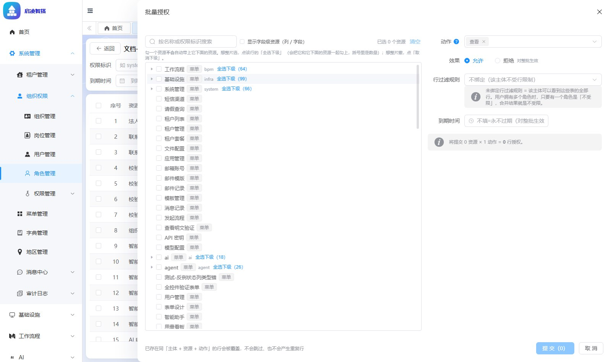 | 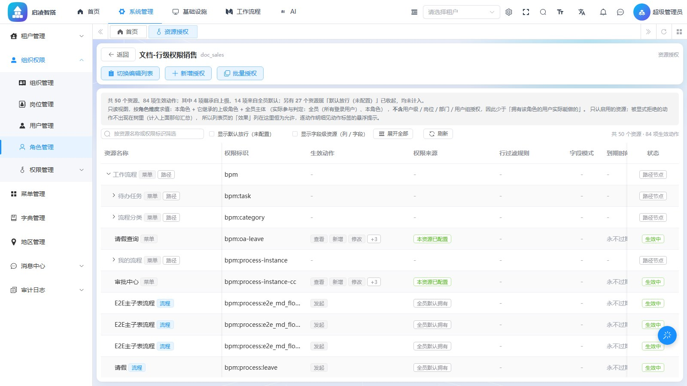 |

三层权限的效果在界面上是这样：**同一个页面、同一段代码**，`docadmin` 看到 8 行含「联系邮箱」列，`docsales` 只看到 2 行、整列消失，打开编辑弹窗时联系手机只读、法人证件号整个字段不出现。

| 行级权限用户视角：2 条、联系邮箱整列消失 | 字段裁剪：联系手机只读、法人证件号不出现 | 权限诊断：症状 → 根因 → 去哪查 |
| --- | --- | --- |
|  |  |  |

### ★ 低代码运行时界面

`src/views/infra/` 下这些页面是上游完全没有的：

| 目录 | 内容 |
| --- | --- |
| `dataModel/` | 数据模型（在线建表与结构变更）：`DataModelForm.vue`、`DataModelImportForm.vue`、`DataModelLogList.vue`、`data/`（数据查看） |
| `formDesign/` | 表单设计：`index.vue` 列表 + `editor/` 设计器 + `render/` 运行时 |
| `dataInterface/` | 数据接口（把一段 SQL / JSON / HTTP 变成取数端点） |
| `portal/` | 门户设计：`editor/` 布局画布 + 发布 |
| `billTemplate/` | 取号管理：`BillTemplateForm.vue`、`BillTemplateLogList.vue`、`BillTemplateTestPanel.vue` |

另有 `build/` 是独立的 form-create 设计器画布页（`fc-designer`），已适配 vendored 源码 —— 它对渲染时机很敏感，`v-if` 必须门控 `ContentWrap` 本身而不是里面的 `<fc-designer>`，原因写在该文件顶部注释里。

配套的重型组件在 `src/components/`：`Form*` 系列（`FormCreate` / `FormWidgets` / `FormLogic` / `FormValidation` / `FormScript` / `FormFormula` / `FormPrint` / `FormTab` / `FormButton` / `FormInput`）、`DiyEditor`、`MagicCubeEditor`、`Portal`、`CodeEditor`、`JsonEditor`、`Table` / `TableActions`。

| 数据模型：结构设计 | 表单设计器：控件库 + 画布 + 配置面板 | 逻辑与扩展：联动规则 / 跨字段校验 |
| --- | --- | --- |
| 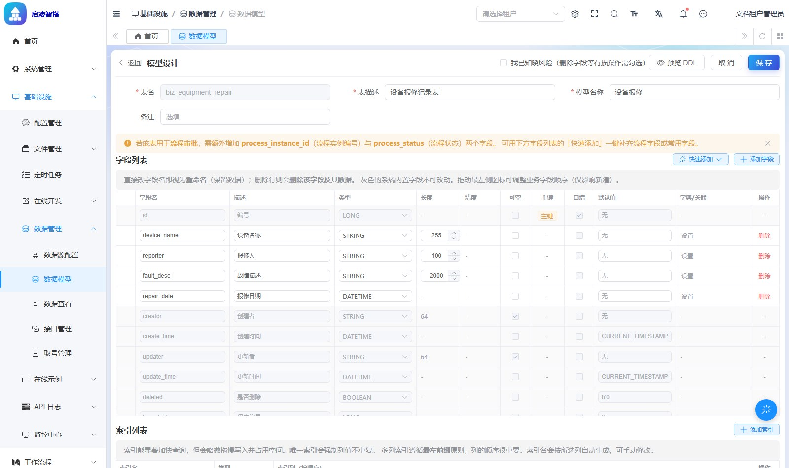 |  | 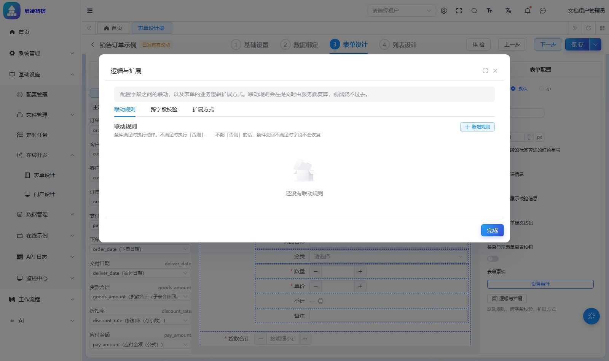 |

| 列表设计：列序 / 宽度 / 对齐 / 固定 / 格式化 | 表单运行时：查询区 + 合计列表 + 行内操作 | 门户设计器：24 栏画布 |
| --- | --- | --- |
| 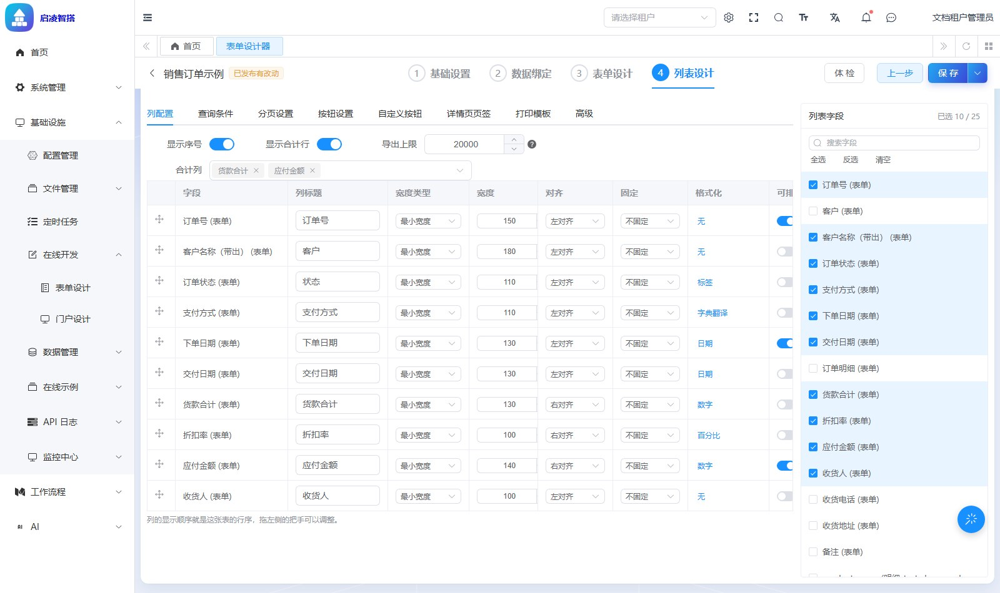 | 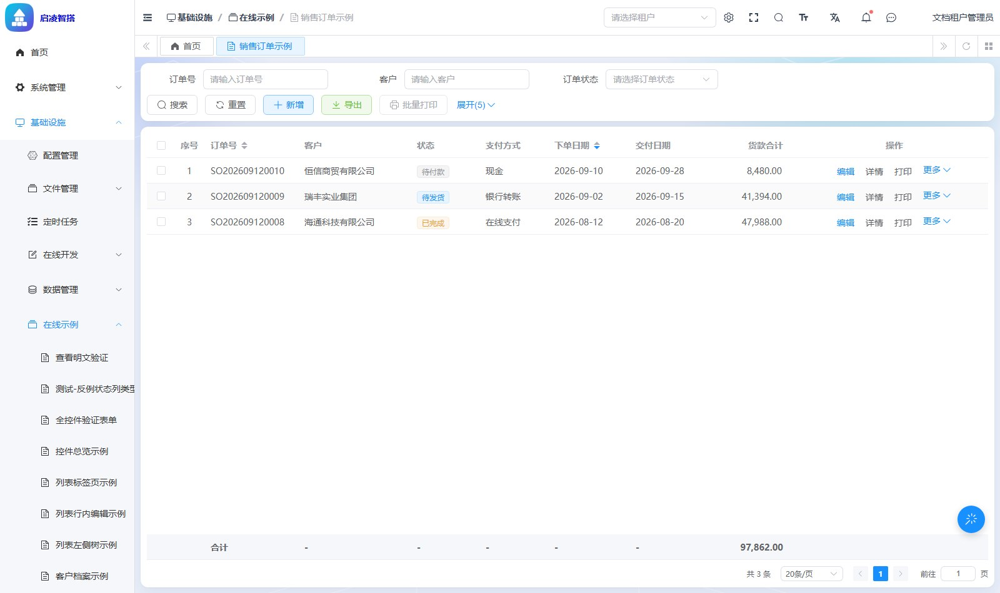 |  |

| 数据接口：SQL 编辑区 + 表结构树 | 取号管理 | 门户首页：按登录身份取数渲染 |
| --- | --- | --- |
| 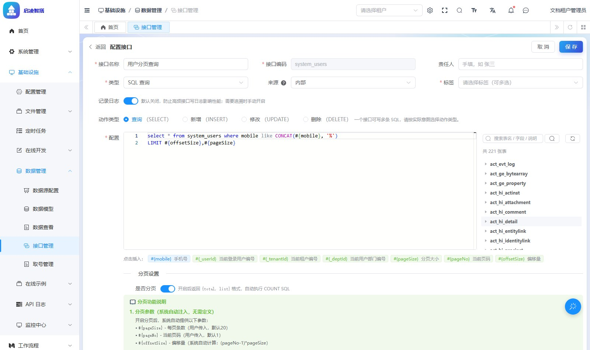 | 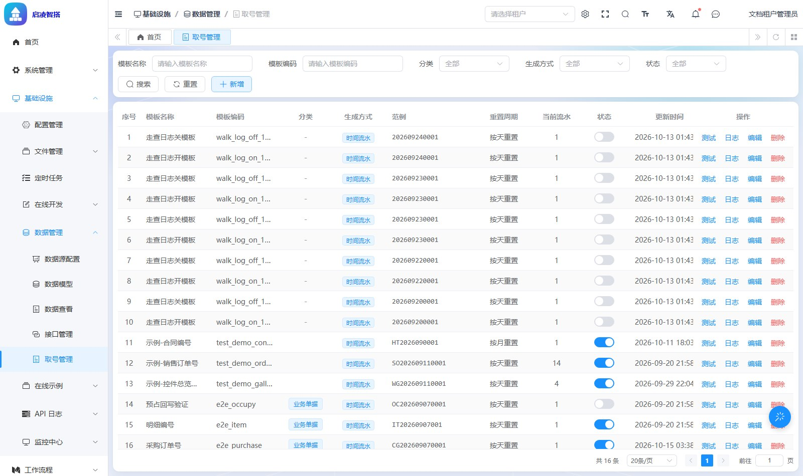 | 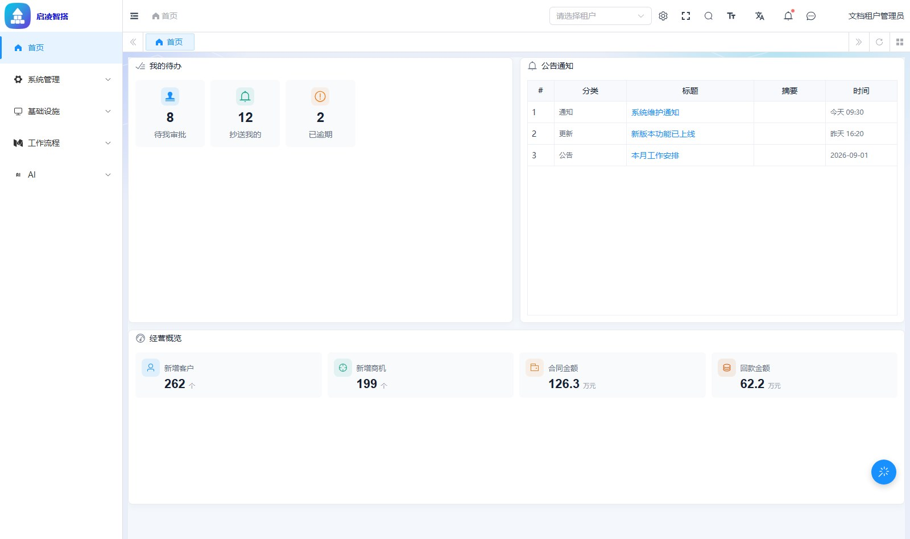 |

### ★ AI 与 Agent 界面

`src/views/agent/`：`assistant`（智能助手对话，SSE 流式）、`workflow`（流程编排画布）、`def`（智能体管理）、`tooldef`（工具管理）、`promptTemplate`（提示词模板）、`usage`（用量看板）、`config`（助手配置）。 `src/views/ai/`：`model` / `chat` / `knowledge` / `image` / `music` / `mindmap` / `write`（上游 AI 域）。

AI 助手答案的「知识引用」带可点来源，**只有手册站地址才渲染成链接**。

| 一次完整问答 | 「已深度思考」逐段展开 | 草稿卡：变更预演 + 确认并运行 |
| --- | --- | --- |
| 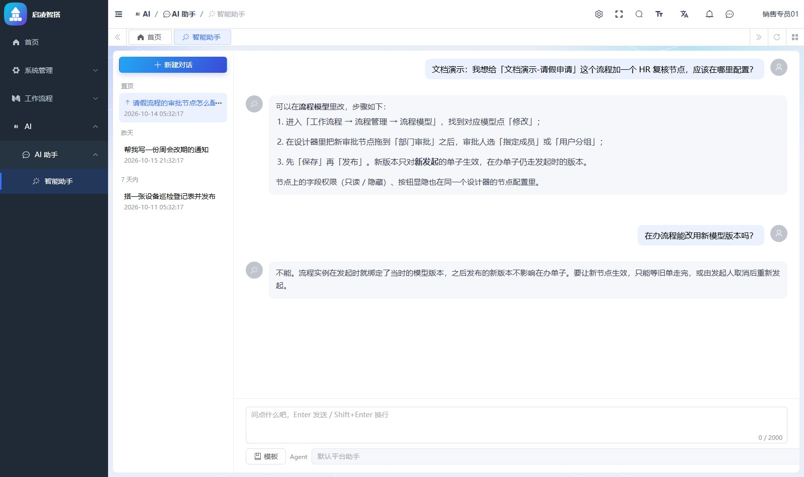 | 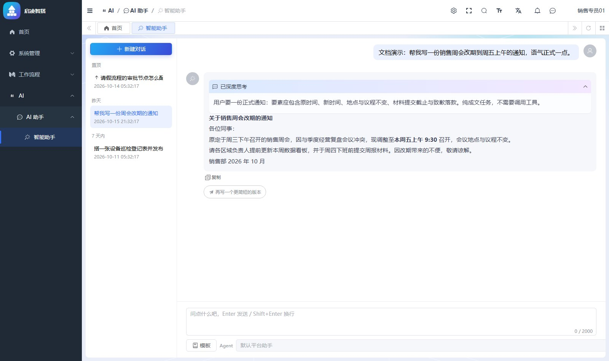 | 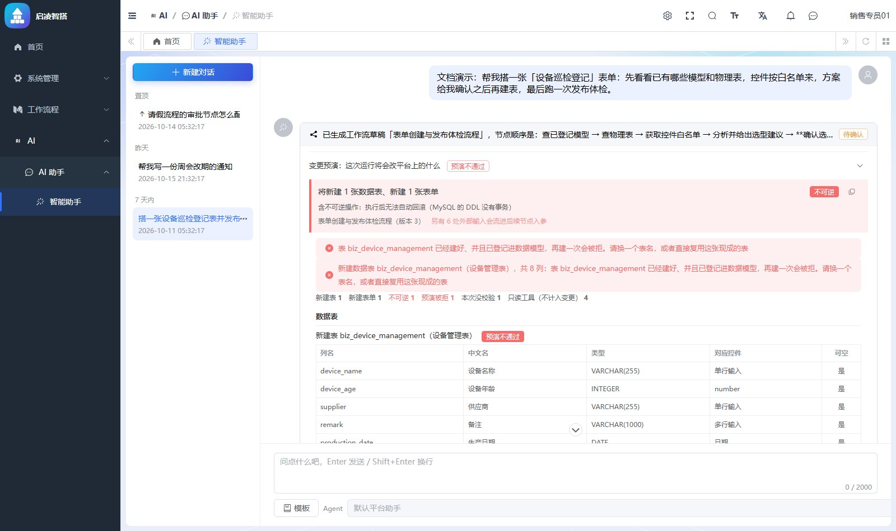 |

| 工作流编辑器画布                           | 节点目录：13 种节点类型                   |
| ------------------------------------------ | ----------------------------------------- |
|  | 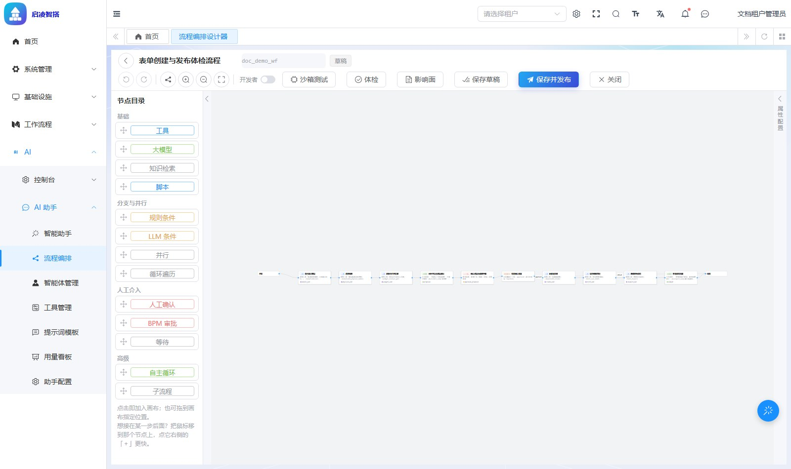 |

### ★ 工作流（BPM）界面

| SIMPLE 仿钉钉设计器                      | BPMN 设计器（bpmn-js）               |
| ---------------------------------------- | ------------------------------------ |
| 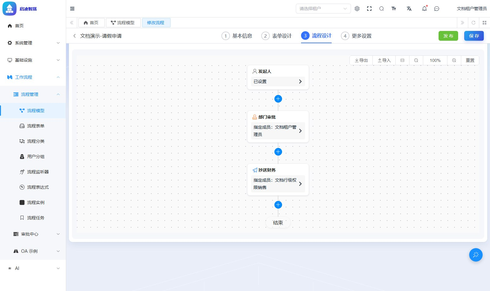 | 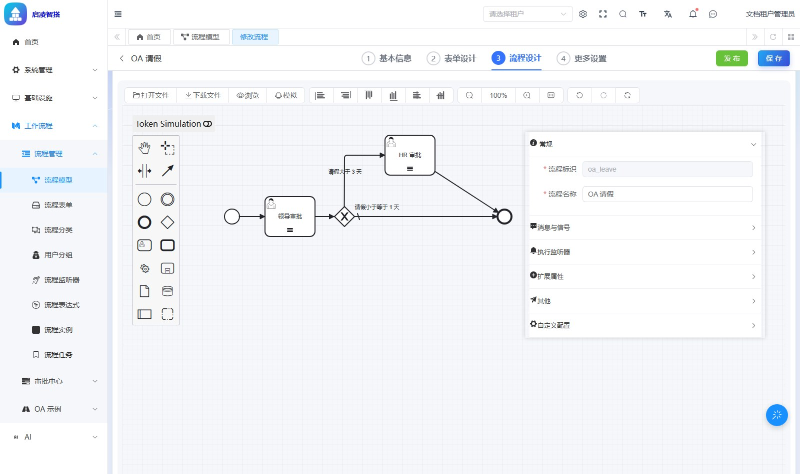 |

### ★ vendored form-create（务必先读 VENDOR.md）

`src/lib/form-create/` 与 `src/lib/form-designer/` 是上游 [form-create](https://github.com/xaboy/form-create) `v3.2.38` 的**源码副本**，不是 npm 依赖，共 212 个文件。要求与上游**保持零 diff**，已在 ESLint 中排除（`eslint.config.mjs` 的 `ignores`）。

- 不要修改、重排格式或「顺手优化」—— 上游包之间用的是源码路径引用（`@form-create/core/src/index` 这类），层级必须原样保留；
- 集成背景、copy 白名单与升级流程见 `src/lib/form-create/VENDOR.md`；
- 🔴 `vite.config.ts` 里对应的 alias **顺序敏感**，改动前先读那几行注释。

---

## 🛠️ 工程约定

### 自动导入

`build/vite/index.ts` 已经把这些全局自动导入 / 注册：

- Vue 与 vue-router 的**全部** API；
- `useI18n`、`useMessage`、`useTable`、`useCrudSchemas`、`DICT_TYPE`；
- `src/components/**` 下所有组件、全部 Element Plus 组件。

显式再写 `import { ref } from 'vue'` 只是冗余、不会报错。

🔴 **`src/types/auto-*.d.ts` 是 gitignore 掉的、仅由 dev server 生成**（`dts: !isBuild`）。新增组件后要先跑一次 `pnpm dev` 再跑 `pnpm ts:check`，否则会报找不到组件。

### 代码风格

只列与默认不同的：

| 工具 | 关键规则 |
| --- | --- |
| Prettier | `semi: false`、`printWidth: 100`、`singleQuote: true`、`trailingComma: 'none'`、`arrowParens: 'always'`、`vueIndentScriptAndStyle: false` |
| 缩进 | 2 空格 |
| ESLint | 关掉了大量 vue/TS 规则（`no-explicit-any`、`no-unused-vars`、`attributes-order`、`multi-word-component-names` 等），但**强制 `vue/html-self-closing`** |
| Stylelint | 强制 `properties-order` |

提交前跑 `pnpm lint`。

🔴 `lint-staged.config.mjs` 有配置、`@commitlint/*` 在 devDependencies 里，但仓库**既没有 husky 也没有 `pre-commit` / `commit-msg` 钩子，commitlint 连配置文件都没有** —— 两者都不会自动触发，别指望它们拦住你。commit message 用的是本项目的非标准格式：

```
type（范围）：中文描述
```

**全角括号与全角冒号**，type 取 `feat` / `fix` / `refactor` / `chore` / `docs`，范围用中文（如 `前端`、`UI`、`表单`），描述写清行为变化与动机。

---

## 🌍 环境变量与构建

### 六个 env 文件

| 文件 | 用途 | `VITE_BASE_URL` |
| --- | --- | --- |
| `.env` | 公共：标题、端口、租户与验证码开关、默认登录账号、API 加解密 | — |
| `.env.local` | 本地开发（**入库**） | `http://localhost:48080` |
| `.env.dev` | 远端演示环境 | `http://api-dashboard.enlev.cn` |
| `.env.test` | 测试 | `http://localhost:48080` |
| `.env.stage` | 预发 | `http://api-dashboard.enlev.cn` |
| `.env.prod` | 生产，同源相对路径 | `''`（空） |

### 构建产物

```bash
pnpm build:prod     # 产物 dist-prod/，约 32 MB / 1017 个文件
```

`vite.config.ts` 的 `build` 块里有几处刻意取舍：

- `outDir: env.VITE_OUT_DIR || 'dist'`，`base: env.VITE_BASE_PATH`（子路径部署改这里）；
- `chunkSizeWarningLimit: 2000`、`reportCompressedSize: false`；
- 手动分包四组：`echarts`、`form-create`、`form-designer`、`monaco-editor`。🔴 form-create 已 vendored 到 `src/lib`，这两条 `test` 匹配的是 **`src/lib/...` 而不是 `node_modules`**，改了位置要跟着改，否则它会散进主 chunk；
- 🔴 **sourcemap 必须走独立 `.map` 文件，不要内联**。内联时 Vite 的 `build-import-analysis` 会对 chunk 做 `replace(convertSourceMap.mapFileCommentRegex, '')`，这个正则在本项目体量的 chunk 上会回溯到爆栈（`RangeError: Maximum call stack size exceeded`），构建直接失败。

### 部署

`.env.prod` 里 `VITE_BASE_URL=''` + `VITE_API_URL=/admin-api`，所以生产包发出的请求是**同源相对路径**。仓库里没有任何 nginx 配置，最小可用骨架：

```nginx
server {
    listen 80;
    root /var/www/dist-prod;
    index index.html;

    location /admin-api/ {
        proxy_pass http://127.0.0.1:48080/admin-api/;
        proxy_set_header Host $host;
        proxy_set_header X-Real-IP $remote_addr;
        proxy_set_header X-Forwarded-For $proxy_add_x_forwarded_for;
        proxy_buffering off;        # AI 对话与工作流走 SSE，默认缓冲会让流式输出攒到结束才吐
        proxy_read_timeout 600s;
    }

    location / {
        try_files $uri $uri/ /index.html;   # history 路由必须回落 index.html
    }
}
```

`proxy_buffering off` 不是可选优化：不关的话用户看到的是「转圈很久然后一次性刷出一大段」。另外 `.env` 里的 `VITE_APP_API_ENCRYPT_ENABLE=true` 表示接口走 AES 加解密（`X-Api-Encrypt` 头），生产环境的密钥要换掉仓库里那对演示密钥。

---

## 🧪 测试

```bash
pnpm test:unit                                  # 全量
pnpm vitest run src/components/FormLogic        # 单个目录
pnpm test:unit:watch                            # watch
```

`vitest.config.ts` **独立于** `vite.config.ts`（后者带着一整套构建插件，跑单测时全是无谓开销），`environment: 'node'`、`include: ['src/**/*.spec.ts']`。

用例集中在三处（59 个 spec 的实际分布）：

| 位置 | spec 数 | 测什么 |
| --- | --- | --- |
| `src/components/Form*`（`FormWidgets` 21、`FormLogic` 3、`FormCreate/src/subtable` 3、`FormScript` / `FormFormula` 各 2 …） | 34 | 控件联动规则求值器、公式、脚本沙箱这类纯逻辑 |
| `src/views/agent/workflow/`（含 `editor/`） | 15 | 流程编排画布的 DSL 与节点编辑 |
| `src/views/system/{role/grant,resource,rule}` | 5 | 资源树、生效树、批量授权、动作词表 |

其余散在 `src/utils`、`src/config/axios`、`src/views/bpm` 等处。

另有一类**源码扫描式守卫**：读 `.ts` / `.vue` 原文做正则断言，把「约定」变成「撞红」。典型是 `src/utils/commentLineRefBan.spec.ts`（禁止注释里写行号引用）与 `src/config/axios/service.spec.ts`（错误形状）。

🔴 vitest 冷启动偶发超时，重跑一次通常就好。

---

## 🐷 演示图

完整截图（316 张，含五个视角对照）在 <https://doc.enlev.cn/guide/>。

### 界面与主题

| 模块 | biu | biu | biu |
| --- | --- | --- | --- |
| 登录 & 首页 |  |  |  |
| 布局三区 |  |  |  |
| 主题 & 配置 | 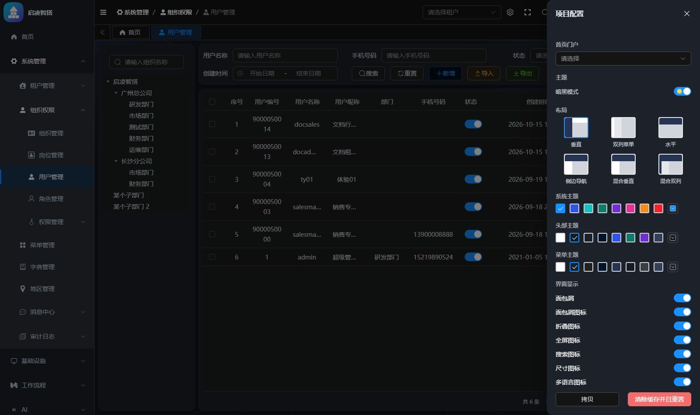 | 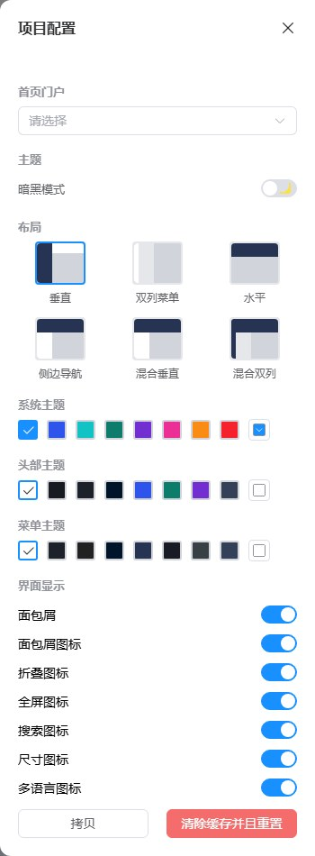 | - |

### CRUD 通用形态

| 模块 | biu | biu | biu |
| --- | --- | --- | --- |
| 查询 & 字典 |  | 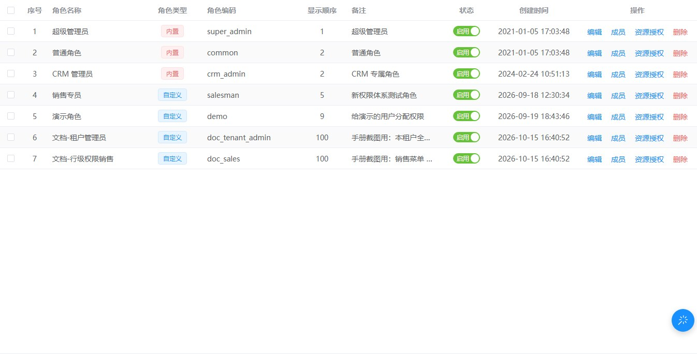 | 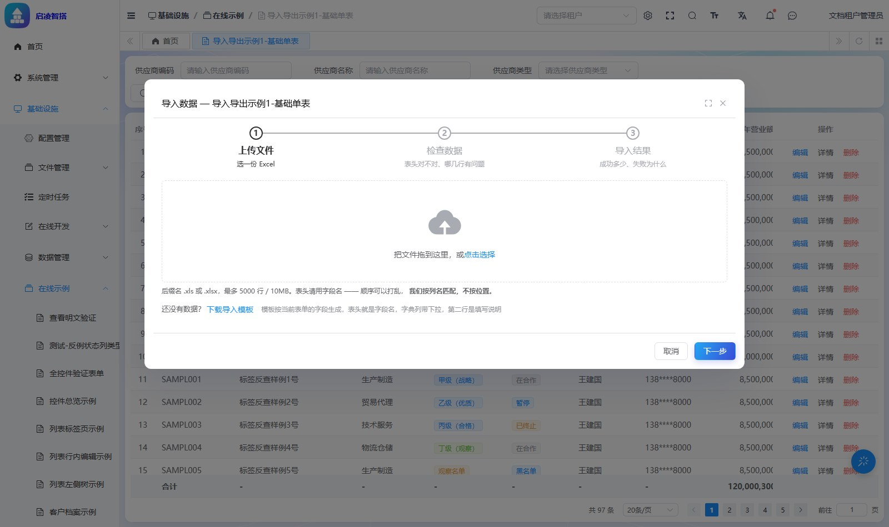 |
| 运行时 |  |  |  |

### 设计器

| 模块 | biu | biu | biu |
| --- | --- | --- | --- |
| 表单设计 |  |  |  |
| 门户 & 数据接口 |  |  | - |
| 流程 & 工作流 |  |  |  |

### 权限与 AI

| 模块 | biu | biu | biu |
| --- | --- | --- | --- |
| 资源授权 |  |  |  |
| 三层权限效果 |  |  |  |
| 智能助手 |  |  |  |

---

## 🧭 常见坑速查

| 现象 | 原因与处置 |
| --- | --- |
| `pnpm ts:check` 报找不到刚加的组件 | `src/types/auto-*.d.ts` 只由 dev server 生成，先跑一次 `pnpm dev`（见「自动导入」） |
| `pnpm dev-server` 看到的数据不是本地后端的 | 它指向远端 `api-dashboard.enlev.cn`，本地开发用 `pnpm dev` |
| 生产包登录页没有验证码 | `.env.local` 掺进了 `build:prod`，见「加载顺序与一个生产陷阱」 |
| `pnpm test:e2e` 报找不到 config | 它本来就是坏的，`playwright.config.ts` 与 `tests/e2e/` 都不存在 |
| 菜单点进去白屏且控制台零报错 | 菜单的 `component` 路径与 `src/views/` 下的实际文件对不上；路径匹配不上就是白屏 |
| 改了菜单但界面没变 | 菜单有 Redis 缓存，直接 INSERT 数据库不会清缓存，去后端清或走界面改 |
| `build:prod` 爆栈 `Maximum call stack size exceeded` | sourcemap 被改成内联了，改回独立 `.map` |
| form-create 相关改动引发大面积 diff | 那两个目录要求与上游零 diff，先读 `src/lib/form-create/VENDOR.md` |
| `pnpm install` 后依赖树诡异 | 用了 npm / yarn，删 `node_modules` 重装，只用 pnpm |
| 用超管账号测不出任何权限问题 | 超管在后端决策引擎前就短路放行了，换 `docadmin` / `docsales` / `salesman01` |

---

## 📚 文档

产品手册与开发手册部署在 <https://doc.enlev.cn>：

| 想了解 | 去哪 |
| --- | --- |
| 用演示账号登录、认识界面四大区域 | 使用手册 [快速开始](https://doc.enlev.cn/guide/quick-start) |
| 通用操作约定（查询区、字典标签、导入导出、页签、配置抽屉） | 使用手册 [通用操作约定](https://doc.enlev.cn/guide/conventions) |
| 界面上每个菜单怎么用（含截图与五个视角对照） | 使用手册 `01-system` ~ `04-ai` |
| 从零搭一个应用 / 配行级权限 / 表单接审批流 / 让 AI 安全读写数据 | 使用手册 [场景教程](https://doc.enlev.cn/guide/05-scene/build-app) |
| 六个端到端实操案例 | 使用手册 [场景案例](https://doc.enlev.cn/guide/06-case/) |
| 本地把前后端跑起来 | 开发手册 [环境准备与启动](https://doc.enlev.cn/develop/00-intro/setup) |
| 前端工程结构、路由与权限机制、组件与 hooks、axios 封装 | 开发手册 `00-intro/{frontend-structure,router-permission,components-hooks,axios-api}` |
| 低代码四域的前后端链路 | 开发手册 `01-lowcode/` |
| 授权 / 诊断页背后的判定逻辑 | 开发手册 `02-permission/` |
| Agent 前端流式（SSE）实现 | 开发手册 `03-agent/frontend-sse` |
| 移动端工程结构、请求与登录态、`system_nav_node` 全链路、多端构建与坑位 | [移动端仓库 README](https://gitee.com/enlev/ainb-ui-admin-uniapp)（开发手册的 `05-mobile/` 章正在补） |
| 新增一个菜单功能端到端、测试规范、坑位索引 | 开发手册 `05-practice/` |

---

## 🙏 鸣谢

启凌智搭不是从零写出来的。它站在五个优秀的开源项目肩膀上，我们对上游作者的工作抱有真诚的敬意 —— 没有他们的开源，就没有本项目的起点。

其中前三个是**本仓库自己**的上游；后两个是同产品移动端仓库 [`ainb-ui-admin-uniapp`](https://gitee.com/enlev/ainb-ui-admin-uniapp) 的上游，**本仓不含它们的任何代码**，在此一并署名只是为了让「启凌智搭」这个产品整体的归属在一处看全 —— 移动端仓有自己的 `THIRD-PARTY-NOTICES.md` 与 `licenses/`，两份清单内容不同是应当的，不要互相对齐成一样。

### [yudao-ui-admin-vue3](https://gitee.com/yudaocode/yudao-ui-admin-vue3) · 芋道源码

本仓库的**直接底座**。它基于 Vue 3 + Vite + Element Plus 提供了一套完整、成熟、可直接投产的管理后台前端方案：动态路由与按钮级权限方案、SaaS 多租户切换、完善的国际化、二次封装的通用组件与 hooks、丰富的业务示例，以及一整套 ESLint / Prettier / Stylelint 规范。启凌智搭的资源授权页、低代码设计器、Agent 对话界面都建在这套骨架之上，`useTable` / `useCrudSchemas` 这些每天都在用的 hooks 也来自它。感谢 [芋道源码](https://gitee.com/yudaocode) 与 yudao-ui-admin-vue3 全体贡献者。

### [ruoyi-vue-pro](https://gitee.com/zhijiantianya/ruoyi-vue-pro) · 芋道源码

本项目的**后端底座**（`ainb`）。芋道源码以开发者为中心，把 Spring Boot 多模块架构、多租户、工作流、支付、商城、CRM、ERP、AI 大模型等一整套企业级能力做成了全部开源、可 100% 免费使用的快速开发平台。前端每一个页面的接口形状、字典约定、分页协议、错误码结构，都来自这套后端的长期打磨 —— 前后端能这样严丝合缝地配对，靠的是上游把约定写清楚了。感谢 ruoyi-vue-pro 全体贡献者。

### [form-create](https://github.com/xaboy/form-create) · xaboy

本项目表单设计器与运行时的**渲染引擎**，也是本仓库里唯一以**源码副本**形式存在的第三方库。form-create 是一个用 JSON 驱动表单生成与渲染的开源库，配套 [form-create-designer](https://github.com/xaboy/form-create-designer) 提供可视化设计器 —— 这正是「拖拽即设计」能成立的底层原因。

我们没有把它当 npm 依赖装，而是把 `v3.2.38` 的源码 vendored 进 `src/lib/{form-create,form-designer}/`（212 个文件），以便在不 fork 上游包的前提下深度改造渲染层（自研控件、字段映射一键生成、设计期体检、列表设计、逻辑与扩展）。**代价是我们承诺这两个目录与上游保持零 diff**：所有定制都写在外围，ESLint 排除、Vite alias 顺序、手动分包规则都围绕这一点配置，升级流程与 copy 白名单记录在 `src/lib/form-create/VENDOR.md`。感谢 [xaboy](https://github.com/xaboy) 与 form-create 社区的长期维护。

> 移动端**不内嵌** form-create 源码：它把 form-create 的规则模型（rule model）用 uni-app + TypeScript 独立实现了一遍（`src/pages-bpm/components/form-create/packages/{core,utils,wot-ui}`），渲染目标是 `@wot-ui/ui` 而不是 Element Plus。规则格式与 API 概念仍源自 form-create，因此移动端仓同样保留了它的协议文本。在线表单另有适配层 `src/pages-infra/form-design/run/components/rule-adapter.ts`，把 Web 设计器多出来的控件差异全部收在一处，`packages/` 一行不动 —— 这也是上表「控件覆盖差」的判定依据。

### [yudao-ui-admin-uniapp](https://gitee.com/yudaocode/yudao-ui-admin-uniapp) · 芋道源码

移动端仓库 `ainb-ui-admin-uniapp` 的**业务页面底座**：`src/pages-*` 各分包、`src/components/yudao-ui/` 下的 `yd-*` 组件、`src/http/` 请求封装与 `src/store/` 状态管理都来自它。它让移动端能直接复用与 Web 端同一套接口形状、字典约定与分页协议 —— 这也是三仓「同一套后端、同一套权限体系」得以成立的前提。感谢 [芋道源码](https://gitee.com/yudaocode) 与 yudao-ui-admin-uniapp 全体贡献者。

### [unibest](https://github.com/feige996/unibest) · 菲鸽

移动端仓库的**工程骨架**（v4.1.0，MIT，`Copyright (c) 2025 菲鸽`）：Vite 配置、约定式路由（`@uni-helper/vite-plugin-uni-pages` + `definePage`）、UnoCSS 原子化样式、多端构建脚本、`env/` 分环境叠加与 eslint / husky / commitlint 工程化。移动端能一套代码同时出 H5、各家小程序与 App，靠的是这层骨架。感谢 [菲鸽](https://github.com/feige996) 与 unibest 社区。

移动端还依赖 DCloud 的 [uni-app](https://github.com/dcloudio/uni-app) 全家桶（**Apache-2.0**）、[`@wot-ui/ui`](https://github.com/wot-ui/wot-ui)（原 wot-design-uni，MIT，`Copyright (c) 2023 weisheng`）与 [z-paging](https://github.com/SmileZXLee/uni-z-paging)（MIT，`Copyright (c) 2021 李兆祥`）—— 完整清单在移动端仓的 `THIRD-PARTY-NOTICES.md`，本仓不重复收录。

### 其他开源组件

本项目还依赖 Vue、Vite、TypeScript、Element Plus、Pinia、UnoCSS、vue-i18n、vueuse、bpmn-js、@vue-flow/core、Monaco Editor、CodeMirror 5、wangEditor-next、ECharts、Vitest 等大量第三方开源组件。

各组件**按其原始许可协议授权，不因本项目以 MIT 发布而变成 MIT**。绝大多数是 MIT，另有 Apache-2.0（`echarts`、`jsoneditor`、`livekit-client`）、BSD-3-Clause（`highlight.js`、`qs`）、ISC（`echarts-wordcloud`）、SIL OFL 1.1 与 CC-BY-4.0（Iconify 图标集 `fa` / `fa-solid` 的数据，经 `addCollection()` 编译进主 chunk）。其中一处**附加义务**要单独点名：`bpmn-js` 是 MIT，但附带「不得移除 bpmn.io 水印」条款，流程设计器上那个 logo 请留着。

逐组件的版本、版权行、协议归类与判定依据见 [THIRD-PARTY-NOTICES.md](./THIRD-PARTY-NOTICES.md)，协议全文见 [`licenses/`](./licenses)。

---

## 📄 许可证

本项目以 **[MIT 协议](./LICENSE)** 开源，Copyright (c) 2026 启凌。

个人与企业可 100% 免费使用，可自由复制、修改、分发，也可用于商业用途。本项目派生自上游 MIT 项目并内嵌 MIT 协议的 form-create 源码副本，完整归属见 [🙏 鸣谢](#-鸣谢)。

⚠️ **MIT 授权只覆盖本项目自己的代码，不覆盖第三方组件**。再分发（含二次开发后对外发布）时请连同 [`THIRD-PARTY-NOTICES.md`](./THIRD-PARTY-NOTICES.md) 与 [`licenses/`](./licenses) 一起分发，并履行其中非 MIT 组件的归属义务 —— 具体是 Apache-2.0 组件的署名、OFL / CC-BY 图标数据的版权声明，以及 bpmn-js 的水印条款。
